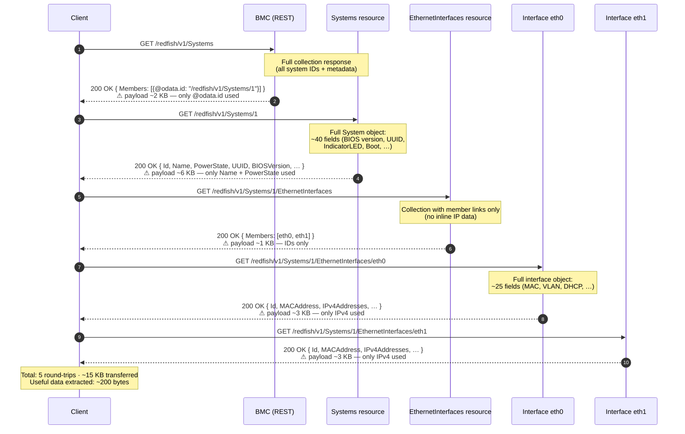
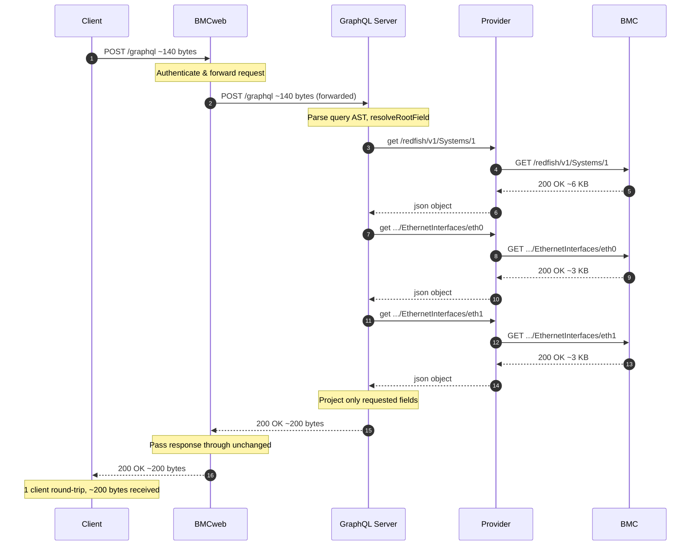

# GraphQL Server — coroserver

A zero-external-dependency, coroutine-based GraphQL server framework built on top of the coroserver HTTP/HTTPS stack. The active example ships a fully functional **Redfish GraphQL Server** and the framework is designed to be extended for any domain-specific schema.

---

## Table of Contents

1. [Architecture Overview](#architecture-overview)
2. [Component Diagram](#component-diagram)
3. [Request Lifecycle](#request-lifecycle)
4. [REST vs GraphQL — Network Traffic Comparison](#rest-vs-graphql--network-traffic-comparison)
5. [Core Abstractions](#core-abstractions)
6. [Building & Running](#building--running)
7. [Redfish Example — Queries](#redfish-example--queries)
8. [Redfish Example — Subscriptions (SSE)](#redfish-example--subscriptions-sse)
9. [Creating a Domain-Specific GraphQL Server](#creating-a-domain-specific-graphql-server)
   - [Step 1 — Define Object Types in the Schema](#step-1--define-object-types-in-the-schema)
   - [Step 2 — Register Root Queries](#step-2--register-root-queries)
   - [Step 3 — Implement the Data Provider](#step-3--implement-the-data-provider)
   - [Step 4 — Implement the Executor](#step-4--implement-the-executor)
   - [Step 5 — Wire the Server Entry Point](#step-5--wire-the-server-entry-point)
10. [Full Walk-through: Inventory GraphQL Server](#full-walk-through-inventory-graphql-server)
11. [API Endpoints](#api-endpoints)
12. [File Reference](#file-reference)
13. [Dependencies](#dependencies)

---

## Architecture Overview

```
┌─────────────────────────────────────────────────────────────────────┐
│                          Client (curl / browser)                    │
│           POST /graphql  { "query": "{ systems { id name } }" }     │
└──────────────────────────────────┬──────────────────────────────────┘
                                   │  HTTPS / TLS
┌──────────────────────────────────▼──────────────────────────────────┐
│                        HttpServer  (coroserver)                     │
│   Boost.Asio io_context · Boost.Beast HTTP · OpenSSL SSL context   │
│                                                                     │
│  ┌──────────────────────────────────────────────────────────────┐  │
│  │                        HttpRouter                            │  │
│  │   POST /graphql ──► handler coroutine                        │  │
│  │   GET  /health  ──► inline handler                           │  │
│  │   GET  /schema  ──► inline handler                           │  │
│  └──────────────────────────────┬───────────────────────────────┘  │
└─────────────────────────────────┼───────────────────────────────────┘
                                  │  co_await executor->execute(query)
┌─────────────────────────────────▼───────────────────────────────────┐
│                        TypedExecutor<Provider>                      │
│  ┌──────────────┐   ┌─────────────────┐   ┌──────────────────────┐ │
│  │   Parser     │   │   TypedSchema   │   │  resolveRootField()  │ │
│  │  (in-tree,   │──►│  validateOp()   │──►│  (override per       │ │
│  │  no deps)    │   │  getRootQuery() │   │   domain)            │ │
│  │  parse()     │   │  getObject()    │   │                      │ │
│  │  validate()  │   └─────────────────┘   └──────────┬───────────┘ │
│  └──────────────┘                                    │             │
│           AST: Operation / FieldSelection / Argument │             │
└─────────────────────────────────────────────────────┼─────────────┘
                                                       │  co_await provider->get(url)
┌──────────────────────────────────────────────────────▼─────────────┐
│                       Provider (abstract)                           │
│   virtual awaitable<json> get(const string& target) = 0            │
│                                                                     │
│   HttpRedfishProvider   ·   MockProvider   ·   YourProvider        │
│   (real HTTPS client)       (unit tests)       (your backend)      │
└────────────────────────────────────────────────────────────────────┘
```

---

## Component Diagram

```
include/graphql/
├── ast.hpp              ← Value, Argument, FieldSelection, Operation  (plain data)
├── parser.hpp           ← Parser::parse() / Parser::validate()
├── typed_schema.hpp     ← ArgumentSpec, FieldSpec, ObjectSpec, TypedSchema
├── typed_executor.hpp   ← TypedExecutor<Provider>  (template base class)
├── simple_schema.hpp    ← lightweight non-typed variant
├── simple_executor.hpp  ← lightweight non-typed variant
└── util.hpp             ← argumentsToJson(), helpers

Domain-specific files (Redfish example):
├── graphql_redfish_schema.hpp/.cpp    ← builds TypedSchema
├── graphql_redfish_provider.hpp/.cpp  ← RedfishProvider (abstract) + HttpRedfishProvider
├── graphql_redfish_executor.hpp/.cpp  ← overrides resolveRootField()
└── graphql_redfish_server.cpp         ← main(): HttpServer + HttpRouter wiring
```

---

## Request Lifecycle

```
Client sends:
  POST /graphql
  { "query": "{ systems { id name powerState } }", "variables": {} }

  Step 1 ── HTTP layer
  HttpServer accepts TLS connection → HttpRouter dispatches to /graphql handler

  Step 2 ── JSON parse
  nlohmann::json::parse(req.body())  → extract "query" and "variables"

  Step 3 ── GraphQL parse
  Parser::validate(query)            → lexical + syntax check (throws on error)
  Parser::parse(query)               → produces Operation (AST root)

  Step 4 ── Schema validation
  TypedSchema::validateOperation()   → checks field names, argument presence/types

  Step 5 ── Execution  (coroutine)
  TypedExecutor::executeSelections() → for each root FieldSelection:
    └── resolveRootField()           → domain-specific override:
          maps field name → backend URL / data source
          co_await provider->get(url) → raw JSON payload

  Step 6 ── Projection
  TypedExecutor::projectObject()     → filters raw JSON to only requested fields
  TypedExecutor::projectField()      → recurses into nested objects / lists

  Step 7 ── Response
  { "data": { "systems": [ { "id": "1", "name": "sys", "powerState": "On" } ] } }
  HTTP 200 returned to client
```

---

## REST vs GraphQL — Network Traffic Comparison

The diagrams below show the same "fetch system name + power state + Ethernet interface
IP addresses" use-case implemented with plain REST/Redfish versus a single GraphQL query.
The contrast illustrates the two main problems GraphQL eliminates:

* **Over-fetching** — REST returns full resource payloads; the client discards unused fields.
* **N+1 round-trips** — fetching related resources (e.g. Ethernet interfaces) requires one
  request per related URL discovered in the previous response.

---

### Scenario: "Get system name, power state, and all Ethernet IP addresses"

---

#### REST / Redfish — 4+ sequential round-trips



---

#### GraphQL — 1 round-trip, fields projected server-side



---

### Summary table

| Dimension | REST / Redfish | GraphQL |
|---|---|---|
| **Client round-trips** | 5 (scales with N interfaces) | **1** (always) |
| **Data transferred to client** | ~15 KB | **~200 bytes** |
| **Over-fetching** | Yes — full objects returned | **No — projection server-side** |
| **Under-fetching (N+1)** | Yes — one request per member link | **No — executor fans out internally** |
| **Client coupling to URL structure** | High (must know every sub-resource URL) | **Low — schema-driven, URL-agnostic** |
| **Partial failure handling** | Client must detect per-request | **Executor aggregates; partial `errors` array** |

> **Note:** The GraphQL server still makes the same backend REST calls internally —
> the gain is entirely on the **client-facing** leg: one query, one response,
> exactly the fields requested.

---

## Core Abstractions

### `TypedSchema`  ([`include/graphql/typed_schema.hpp`](include/graphql/typed_schema.hpp))

Holds the full type registry and root query map.

| API | Purpose |
|-----|---------|
| `addObject(ObjectSpec)` | Register a named object type with its fields |
| `addRootQuery(FieldSpec)` | Register a top-level query entry point |
| `getRootQueryField(name)` | Look up a root query by name |
| `getObject(typeName)` | Look up an object type by name |
| `validateOperation(op)` | Validate an AST operation against the schema |

**`FieldSpec`** — describes one field:

```cpp
struct FieldSpec {
    std::string name;        // GraphQL field name  e.g. "powerState"
    std::string responseKey; // key in backend JSON e.g. "PowerState"
    std::string returnType;  // type name           e.g. "String" / "Status"
    bool isList   = false;   // returns an array?
    bool scalar   = false;   // primitive (no sub-selections)?
    std::vector<ArgumentSpec> arguments;
};
```

---

### `TypedExecutor<Provider>` ([`include/graphql/typed_executor.hpp`](include/graphql/typed_executor.hpp))

Template base class — parameterised on the data provider type.

```
             TypedExecutor<Provider>
             ┌───────────────────────────────────────────┐
             │  execute(query, variables)                │  ← public entry
             │    Parser::parse()                        │
             │    schema.validateOperation()             │
             │    executeSelections()                    │
             │      resolveRootField()  ◄── pure virtual │
             │      projectObject()                      │
             │      projectField()                       │
             └───────────────────────────────────────────┘
                              ▲
                              │ override resolveRootField()
              YourGraphQLExecutor : TypedExecutor<YourProvider>
```

The only method you **must** implement is:

```cpp
boost::asio::awaitable<nlohmann::json> resolveRootField(
    const graphql::FieldSelection& selection,
    const graphql::FieldSpec& fieldSpec,
    const nlohmann::json& variables) override;
```

---

### `Parser`  ([`include/graphql/parser.hpp`](include/graphql/parser.hpp))

Zero-dependency handwritten recursive-descent lexer + parser.  Produces an `Operation` AST.

```
Parser::parse(queryString)
  └── Impl::parseDocument()
        ├── parseOperation()      (query / mutation / subscription)
        │     ├── parseVariableDefinitions()
        │     └── parseSelectionSet()
        │           └── parseField()
        │                 ├── parseArguments()
        │                 └── parseSelectionSet()  (recursive)
        └── returns Operation { type, name, variableDefinitions, selections }
```

---

## Building & Running

```bash
# From the coroserver root
meson setup build
meson compile -C build

# The executable
build/examples/graphql_server/graphql_redfish_server
```

### Command-line options

| Flag | Short | Default | Description |
|------|-------|---------|-------------|
| `--port` | `-p` | `8444` | Listening port |
| `--cert` | `-c` | `/etc/ssl/certs/https` | Directory containing `server-cert.pem` / `server-key.pem` |
| `--host` | `-h` | `localhost` | Redfish target host |
| `--target-port` | `-t` | `443` | Redfish target port |
| `--user` | `-u` | `root` | Redfish username |
| `--password` | `-w` | `0penBmc` | Redfish password |

```bash
./graphql_redfish_server \
  --port 8444 \
  --cert ./examples/graphql_server \
  --host 192.168.1.10 \
  --target-port 443 \
  --user admin \
  --password secret
```

---

## Redfish Example — Queries

### Get service root

```bash
curl -k -X POST https://localhost:8444/graphql \
  -H 'Content-Type: application/json' \
  -d '{"query": "{ serviceRoot { id name } }"}'
```

### List all systems

```bash
curl -k -X POST https://localhost:8444/graphql \
  -H 'Content-Type: application/json' \
  -d '{"query": "{ systems { id name powerState status { health state } } }"}'
```

### Get a single system by ID

```bash
curl -k -X POST https://localhost:8444/graphql \
  -H 'Content-Type: application/json' \
  -d '{"query": "{ system(id: \"1\") { id name powerState processorSummary { count model } } }"}'
```

### Query with variables

```bash
curl -k -X POST https://localhost:8444/graphql \
  -H 'Content-Type: application/json' \
  -d '{
    "query": "query GetSystem($id: ID!) { system(id: $id) { id name powerState } }",
    "variables": { "id": "1" }
  }'
```

### Ethernet interfaces with nested IP addresses

```bash
curl -k -X POST https://localhost:8444/graphql \
  -H 'Content-Type: application/json' \
  -d '{
    "query": "{ ethernetInterfaces { id name macAddress linkStatus ipv4Addresses { address subnetMask gateway } } }"
  }'
```

### Field aliases

```bash
curl -k -X POST https://localhost:8444/graphql \
  -H 'Content-Type: application/json' \
  -d '{
    "query": "{ bmc: managers { id name status { health } } allChassis: chassis { id name } }"
  }'
```

### Fragments — reusable field sets

Fragments let you define a named set of fields once and reuse it in multiple
places.  They are especially useful when the same type appears at several points
in a query (e.g. `Status` on both a system and its chassis).

#### Named fragment — shared status fields

Define a `StatusFields` fragment and spread it into two different root queries in
one request:

```bash
curl -k -X POST https://localhost:8444/graphql \
  -H 'Content-Type: application/json' \
  -d '{
    "query": "query HealthOverview {
      systems {
        id
        name
        powerState
        status { ...StatusFields }
      }
      chassis {
        id
        name
        status { ...StatusFields }
      }
    }
    fragment StatusFields on Status {
      health
      state
    }"
  }'
```

Expected response shape:

```json
{
  "data": {
    "systems": [
      {
        "id": "1",
        "name": "Managed System",
        "powerState": "On",
        "status": { "health": "OK", "state": "Enabled" }
      }
    ],
    "chassis": [
      {
        "id": "1",
        "name": "Rack Chassis",
        "status": { "health": "OK", "state": "Enabled" }
      }
    ]
  }
}
```

#### Named fragment — processor summary details

Reuse processor fields across a single-system query and a full system list:

```bash
curl -k -X POST https://localhost:8444/graphql \
  -H 'Content-Type: application/json' \
  -d '{
    "query": "query ProcessorOverview {
      primary: system(id: \"1\") {
        id
        name
        ...ProcessorFields
      }
      allSystems: systems {
        id
        ...ProcessorFields
      }
    }
    fragment ProcessorFields on ComputerSystem {
      powerState
      processorSummary { count model }
      status { health state }
    }"
  }'
```

#### Inline fragment — type-local fields without a name

Inline fragments (`... on Type { }`) are useful when you want to select
type-specific fields in a single shot without defining a separate fragment:

```bash
curl -k -X POST https://localhost:8444/graphql \
  -H 'Content-Type: application/json' \
  -d '{
    "query": "{ systems {
        id
        name
        ... on ComputerSystem {
          powerState
          processorSummary { count model }
        }
        status { health state }
      }
    }"
  }'
```

#### Combining named fragments, inline fragments, and aliases

```bash
curl -k -X POST https://localhost:8444/graphql \
  -H 'Content-Type: application/json' \
  -d '{
    "query": "query FullInventory {
      bmc: managers {
        id
        name
        ...ManagerHealth
      }
      allChassis: chassis {
        id
        name
        ... on Chassis { status { health state } }
      }
      ethernetInterfaces {
        id
        macAddress
        linkStatus
        ...NetworkAddresses
      }
    }
    fragment ManagerHealth on Manager {
      status { health state }
    }
    fragment NetworkAddresses on EthernetInterface {
      ipv4Addresses { address subnetMask gateway }
      ipv6Addresses { address prefixLength addressState }
    }"
  }'
```

> **Note — fragment placement:** Fragment definitions must appear **after** the
> operation body in the document, as shown above.  The server parses the
> operation first, then reads any `fragment` definitions that follow.

---

## Redfish Example — Subscriptions (SSE)

GraphQL **subscriptions** let a client listen for live data changes without polling.
The server uses **Server-Sent Events (SSE)** over a persistent HTTPS `GET` connection.
Each poll cycle re-fetches the target Redfish resource and pushes the result as a
JSON event on the stream.

### Available subscription fields

| Field | Redfish target | Arguments | Notes |
|-------|---------------|-----------|-------|
| `systemStatus` | `/redfish/v1/Systems/{id}` | `id: ID!` | single object |
| `chassisStatus` | `/redfish/v1/Chassis/{id}` | `id: ID!` | single object |
| `chassisUpdates` | `/redfish/v1/Chassis` | none | full chassis list |
| `ethernetInterfaceUpdates` | `/redfish/v1/Managers/bmc/EthernetInterfaces` | none | all members expanded |
| `sensorUpdates` | `/redfish/v1/Chassis/{chassisId}/Sensors` | `chassisId: ID` (default: `"chassis"`) | all sensors expanded |
| `pcieDeviceUpdates` | `/redfish/v1/Systems/{systemId}/PCIeDevices` | `systemId: ID` (default: `"system"`) | all PCIe devices expanded |
| `pcieDeviceStatus` | `/redfish/v1/Systems/{systemId}/PCIeDevices/{id}` | `systemId: ID`, `id: ID!` | single PCIe device |

### Endpoint

```
GET /graphql/subscribe?query=<subscription-document>[&interval=<seconds>]
```

| Query-string parameter | Default | Description |
|------------------------|---------|-------------|
| `query` | — (required) | URL-encoded GraphQL subscription document |
| `interval` | `5` | Poll interval in seconds |

The response uses:

```
HTTP/1.1 200 OK
Content-Type: text/event-stream
Cache-Control: no-cache
Transfer-Encoding: chunked
```

Each event is delivered as:

```
data: {"data":{"systemStatus":{"id":"1","powerState":"On","status":{"health":"OK"}}}}

data: {"data":{"systemStatus":{"id":"1","powerState":"On","status":{"health":"OK"}}}}
```

### Watch a system's power state and health

```bash
# URL-encode spaces as '+' or %20 in the query string
curl -k -N \
  'https://localhost:8444/graphql/subscribe?query=subscription+%7B+systemStatus(id%3A+"1")+%7B+id+powerState+status+%7B+health+state+%7D+%7D+%7D&interval=5'
```

Decoded subscription document sent in the `query` parameter:

```graphql
subscription {
  systemStatus(id: "1") {
    id
    powerState
    status {
      health
      state
    }
  }
}
```

### Watch chassis status every 10 seconds

```bash
curl -k -N \
  'https://localhost:8444/graphql/subscribe?query=subscription+%7B+chassisStatus(id%3A+"1")+%7B+id+name+status+%7B+health+%7D+%7D+%7D&interval=10'
```

Decoded:

```graphql
subscription {
  chassisStatus(id: "1") {
    id
    name
    status {
      health
    }
  }
}
```

### Consuming events from JavaScript (browser / Node.js)

```javascript
const url =
  'https://bmc-host:8444/graphql/subscribe' +
  '?query=' + encodeURIComponent('subscription { systemStatus(id: "1") { id powerState status { health } } }') +
  '&interval=5';

const es = new EventSource(url);

es.onmessage = (event) => {
  const payload = JSON.parse(event.data);
  if (payload.errors) {
    console.error('Subscription error:', payload.errors);
    es.close();
    return;
  }
  const sys = payload.data.systemStatus;
  console.log(`[${new Date().toISOString()}] ${sys.id} — power: ${sys.powerState}, health: ${sys.status.health}`);
};

es.onerror = () => { es.close(); };
```

### Watch network addresses of all interfaces

`ethernetInterfaceUpdates` is a **list subscription** — every event delivers the full
set of network interfaces with their live IP addresses.

```bash
curl -k -N \
  'https://localhost:8444/graphql/subscribe?query=subscription+%7B+ethernetInterfaceUpdates+%7B+id+macAddress+linkStatus+ipv4Addresses+%7B+address+subnetMask+%7D+ipv6Addresses+%7B+address+%7D+%7D+%7D&interval=10'
```

Decoded subscription document:

```graphql
subscription {
  ethernetInterfaceUpdates {
    id
    macAddress
    linkStatus
    ipv4Addresses {
      address
      subnetMask
    }
    ipv6Addresses {
      address
    }
  }
}
```

Example event pushed every 10 seconds:

```json
{
  "data": {
    "ethernetInterfaceUpdates": [
      {
        "id": "eth0",
        "macAddress": "aa:bb:cc:dd:ee:ff",
        "linkStatus": "LinkUp",
        "ipv4Addresses": [{ "address": "192.168.1.10", "subnetMask": "255.255.255.0" }],
        "ipv6Addresses": [{ "address": "fe80::1" }]
      },
      {
        "id": "eth1",
        "macAddress": "aa:bb:cc:dd:ee:00",
        "linkStatus": "LinkDown",
        "ipv4Addresses": [],
        "ipv6Addresses": []
      }
    ]
  }
}
```

Because this is a list subscription, the server fetches the collection index
(`/redfish/v1/Managers/bmc/EthernetInterfaces`) and then issues a live
`getFresh()` GET for **each member** on every poll cycle — so you always see
the current state of every interface in a single event.

### Watch live sensor readings

`sensorUpdates` is a **list subscription with `expandMembers`** — on every poll the
server fetches the sensor collection index and then issues a live `getFresh()` GET for
**each individual sensor URL**, so every event delivers the current reading, units, and
health of every sensor under the given chassis.

```bash
curl -k -N \
  'https://localhost:8444/graphql/subscribe?query=subscription+%7B+sensorUpdates(chassisId%3A+"chassis")+%7B+id+name+readingType+reading+readingUnits+readingRangeMax+readingRangeMin+status+%7B+health+state+%7D+%7D+%7D&interval=5'
```

Decoded subscription document:

```graphql
subscription {
  sensorUpdates(chassisId: "chassis") {
    id
    name
    readingType
    reading
    readingUnits
    readingRangeMax
    readingRangeMin
    status {
      health
      state
    }
  }
}
```

Omit the argument to use the default chassis (`"chassis"`):

```graphql
subscription {
  sensorUpdates {
    id
    name
    readingType
    reading
    readingUnits
    status { health }
  }
}
```

Example event pushed every 5 seconds:

```json
{
  "data": {
    "sensorUpdates": [
      {
        "id": "Temp_CPU0",
        "name": "CPU 0 Temperature",
        "readingType": "Temperature",
        "reading": 62.5,
        "readingUnits": "Cel",
        "readingRangeMax": 95.0,
        "readingRangeMin": 0.0,
        "status": { "health": "OK", "state": "Enabled" }
      },
      {
        "id": "Fan_0",
        "name": "Fan 0 Speed",
        "readingType": "Rotational",
        "reading": 4800.0,
        "readingUnits": "RPM",
        "readingRangeMax": 10000.0,
        "readingRangeMin": 500.0,
        "status": { "health": "OK", "state": "Enabled" }
      },
      {
        "id": "Volt_12V",
        "name": "12V Rail",
        "readingType": "Voltage",
        "reading": 12.05,
        "readingUnits": "V",
        "readingRangeMax": 12.6,
        "readingRangeMin": 11.4,
        "status": { "health": "OK", "state": "Enabled" }
      }
    ]
  }
}
```

**Consuming sensor events from JavaScript:**

```javascript
const url =
  'https://bmc-host:8444/graphql/subscribe' +
  '?query=' + encodeURIComponent(
    'subscription { sensorUpdates(chassisId: "chassis") { id name readingType reading readingUnits status { health state } } }'
  ) +
  '&interval=5';

const es = new EventSource(url);

es.onmessage = (event) => {
  const payload = JSON.parse(event.data);
  if (payload.errors) {
    console.error('Subscription error:', payload.errors);
    es.close();
    return;
  }
  for (const sensor of payload.data.sensorUpdates) {
    console.log(
      `[${new Date().toISOString()}] ${sensor.name}: ` +
      `${sensor.reading} ${sensor.readingUnits} [${sensor.status.health}]`
    );
  }
};

es.onerror = () => { es.close(); };
```

To watch only sensors whose health has degraded, filter client-side:

```javascript
const degraded = payload.data.sensorUpdates.filter(
  s => s.status.health !== 'OK'
);
if (degraded.length) {
  console.warn('Degraded sensors:', degraded.map(s => s.name));
}
```

### Adding a new subscription field

Only two steps are needed for any new field — the SSE transport, poll loop,
JSON projection and field selection all happen automatically.

**Step 1 — Register in [`graphql_redfish_schema.cpp`](graphql_redfish_schema.cpp)**

Reuse any `ObjectSpec` type already defined for queries:

```cpp
// Object subscription (single resource, requires an id argument)
schema.addRootSubscription(
    {"myField", "", "ExistingType", false, false, {{"id", "ID", true}}});

// List subscription (entire collection, no arguments)
schema.addRootSubscription(
    {"myListField", "", "ExistingType", true, false});
```

**Step 2 — Resolve in [`graphql_redfish_executor.cpp`](graphql_redfish_executor.cpp)**

Add one `else if` branch inside `resolveSubscriptionField()`:

```cpp
// Object/scalar — single resource
else if (selection.name == "myField")
{
    nlohmann::json args = resolveArguments(selection, variables);
    target = "/redfish/v1/SomeResource/" + args["id"].get<std::string>();
    // falls through to the getFresh() call at the bottom
}

// List — expand the collection on every poll
else if (selection.name == "myListField")
{
    nlohmann::json col = co_await provider->getFresh("/redfish/v1/SomeCollection");
    nlohmann::json result = nlohmann::json::array();
    for (const auto& member : col["Members"])
    {
        nlohmann::json item =
            co_await provider->getFresh(member["@odata.id"].get<std::string>());
        result.push_back(
            co_await projectObject(item, fieldSpec.returnType, selection.selections));
    }
    co_return result;
}
```

`getFresh()` always bypasses the local cache so every poll delivers live BMC state.

### How it works internally

```
Client  ──GET /graphql/subscribe?query=...──►  HttpServer
                                                   │
                                          SSE headers written
                                          (chunked, text/event-stream)
                                                   │
                                         TypedExecutor::executeSubscription()
                                                   │
                            ┌──────────────────────┘
                            │  loop every <interval>:
                            │    resolveSubscriptionField()
                            │      └─► provider->getFresh(target)
                            │              └─► Redfish BMC  (live HTTP GET)
                            │    onEvent(json)  ──► SseWriter::write()
                            │      └─► "data: {...}\n\n"  sent to client
                            └──────────────────────►  repeat
```

---

## Creating a Domain-Specific GraphQL Server

The framework requires five artefacts for a new domain.  The Redfish implementation is the reference; the steps below use an **Inventory** domain (servers, racks, and alerts) as a fresh example.

### Step 1 — Define Object Types in the Schema

Create `inventory_schema.cpp`.  Each `ObjectSpec` maps **GraphQL field names** to **backend JSON keys** via `FieldSpec`.

```cpp
// inventory_schema.cpp
#include "graphql/typed_schema.hpp"

graphql::TypedSchema buildInventorySchema()
{
    graphql::TypedSchema schema;

    // ── Scalar-only leaf types ──────────────────────────────────────
    graphql::ObjectSpec alertSpec{
        "Alert",
        {
            // {graphqlName, backendJsonKey, returnType, isList, isScalar}
            {"id",       {"id",       "alertId",   "String", false, true}},
            {"severity", {"severity", "severity",  "String", false, true}},
            {"message",  {"message",  "message",   "String", false, true}},
        }
    };

    // ── Nested object type ──────────────────────────────────────────
    graphql::ObjectSpec serverSpec{
        "Server",
        {
            {"id",       {"id",       "server_id", "String", false, true}},
            {"hostname", {"hostname", "hostname",  "String", false, true}},
            {"rack",     {"rack",     "rack_name", "String", false, true}},
            // isList=true → maps to a JSON array of Alert objects
            {"alerts",   {"alerts",   "alerts",    "Alert",  true,  false}},
        }
    };

    graphql::ObjectSpec rackSpec{
        "Rack",
        {
            {"id",      {"id",      "rack_id",  "String", false, true}},
            {"name",    {"name",    "name",     "String", false, true}},
            // isList=true, isScalar=false → array of nested Server objects
            {"servers", {"servers", "servers",  "Server", true,  false}},
        }
    };

    schema.addObject(std::move(alertSpec));
    schema.addObject(std::move(serverSpec));
    schema.addObject(std::move(rackSpec));

    return schema;
}
```

**`FieldSpec` field meanings at a glance:**

```
{"graphqlName", "backendKey", "ReturnType", isList, isScalar}
                                              │        │
                                              │        └── true  → primitive (String/Int/Boolean)
                                              │            false → resolve sub-selections against ReturnType
                                              └────────── true  → JSON array
                                                          false → single object
```

---

### Step 2 — Register Root Queries

Root queries are the entry points a client can use at the top level of `{ ... }`.

```cpp
// still in inventory_schema.cpp, after addObject() calls

// No arguments — returns a list of Rack objects
schema.addRootQuery({"racks",   "", "Rack",   true,  false});

// No arguments — returns a list of Server objects
schema.addRootQuery({"servers", "", "Server", true,  false});

// Required "id" argument — returns a single Server
schema.addRootQuery({
    "server", "", "Server", false, false,
    {{"id", "String", /*required=*/true}}
});

// Optional severity filter — returns a list of Alerts
schema.addRootQuery({
    "alerts", "", "Alert", true, false,
    {{"severity", "String", /*required=*/false}}
});

return schema;
```

---

### Step 3 — Implement the Data Provider

The provider interface has a single coroutine method.  Implement it to fetch data from your backend (REST API, database, D-Bus, etc.).

```cpp
// inventory_provider.hpp
#pragma once
#include <boost/asio/awaitable.hpp>
#include <nlohmann/json.hpp>
#include <string>

class InventoryProvider {
public:
    virtual ~InventoryProvider() = default;
    virtual boost::asio::awaitable<nlohmann::json>
        get(const std::string& resource) = 0;
};

// ── Concrete implementation ─────────────────────────────────────────
class HttpInventoryProvider : public InventoryProvider {
public:
    HttpInventoryProvider(boost::asio::io_context& io,
                          const std::string& baseUrl);

    boost::asio::awaitable<nlohmann::json>
        get(const std::string& resource) override;

private:
    boost::asio::io_context& io_;
    std::string baseUrl_;
    // ... HTTP client members
};

// ── In-process mock (unit tests / development) ──────────────────────
class MockInventoryProvider : public InventoryProvider {
public:
    boost::asio::awaitable<nlohmann::json>
        get(const std::string& resource) override
    {
        if (resource == "/inventory/racks")
        {
            co_return nlohmann::json::array({
                {{"rack_id","R1"},{"name","Rack-A"},{"servers",nlohmann::json::array()}},
                {{"rack_id","R2"},{"name","Rack-B"},{"servers",nlohmann::json::array()}}
            });
        }
        if (resource == "/inventory/servers")
        {
            co_return nlohmann::json::array({
                {{"server_id","S1"},{"hostname","web-01"},{"rack_name","Rack-A"},{"alerts",nlohmann::json::array()}},
                {{"server_id","S2"},{"hostname","db-01"}, {"rack_name","Rack-B"},{"alerts",nlohmann::json::array()}}
            });
        }
        co_return nlohmann::json::object();
    }
};
```

---

### Step 4 — Implement the Executor

Override `resolveRootField()` to map each root query name to a backend fetch.

```cpp
// inventory_executor.hpp
#pragma once
#include "graphql/typed_executor.hpp"
#include "inventory_provider.hpp"

class InventoryGraphQLExecutor
    : public graphql::TypedExecutor<InventoryProvider>
{
public:
    InventoryGraphQLExecutor(graphql::TypedSchema schema,
                             std::shared_ptr<InventoryProvider> provider)
        : graphql::TypedExecutor<InventoryProvider>(
              std::move(schema), std::move(provider))
    {}

protected:
    boost::asio::awaitable<nlohmann::json> resolveRootField(
        const graphql::FieldSelection& selection,
        const graphql::FieldSpec& fieldSpec,
        const nlohmann::json& variables) override;
};

// inventory_executor.cpp
boost::asio::awaitable<nlohmann::json>
InventoryGraphQLExecutor::resolveRootField(
    const graphql::FieldSelection& selection,
    const graphql::FieldSpec& fieldSpec,
    const nlohmann::json& variables)
{
    nlohmann::json args = resolveArguments(selection, variables);
    std::string resource;

    if (selection.name == "racks")
        resource = "/inventory/racks";
    else if (selection.name == "servers")
        resource = "/inventory/servers";
    else if (selection.name == "server")
        resource = "/inventory/servers/" + args["id"].get<std::string>();
    else if (selection.name == "alerts")
        resource = "/inventory/alerts";
    else
        throw std::runtime_error("Unknown field: " + selection.name);

    nlohmann::json payload = co_await provider->get(resource);

    // ── List result: each element is projected through its ObjectSpec ──
    if (fieldSpec.isList)
    {
        if (!payload.is_array())
            throw std::runtime_error("Expected array for " + selection.name);

        nlohmann::json result = nlohmann::json::array();
        for (const auto& item : payload)
            result.push_back(
                co_await projectObject(item, fieldSpec.returnType,
                                       selection.selections));
        co_return result;
    }

    // ── Single object result ──────────────────────────────────────────
    co_return co_await projectObject(payload, fieldSpec.returnType,
                                     selection.selections);
}
```

**`resolveArguments()`** (inherited from `TypedExecutor`) converts the `FieldSelection`'s argument list to a `nlohmann::json` object, substituting `$variable` references from the `variables` map automatically.

---

### Step 5 — Wire the Server Entry Point

```cpp
// inventory_server.cpp
#include "graphql/typed_schema.hpp"
#include "http_server.hpp"
#include "inventory_executor.hpp"
#include "inventory_provider.hpp"

int main(int argc, const char* argv[])
{
    boost::asio::io_context io;

    // 1. Schema
    auto schema = buildInventorySchema();

    // 2. Provider  (swap MockInventoryProvider for unit tests)
    auto provider = std::make_shared<MockInventoryProvider>();

    // 3. Executor
    auto executor = std::make_shared<InventoryGraphQLExecutor>(
        std::move(schema), provider);

    // 4. SSL context
    boost::asio::ssl::context ssl(boost::asio::ssl::context::sslv23);
    ssl.use_certificate_chain_file("server-cert.pem");
    ssl.use_private_key_file("server-key.pem", boost::asio::ssl::context::pem);

    // 5. Router
    HttpRouter router;
    router.setIoContext(io);

    router.add_post_handler(
        "/graphql",
        [executor](Request& req, const http_function&)
            -> net::awaitable<Response>
        {
            auto body = nlohmann::json::parse(req.body(), nullptr, false);
            if (body.is_discarded() || !body.contains("query"))
                co_return make_bad_request_error("Missing query", req.version());

            nlohmann::json vars = body.value("variables", nlohmann::json::object());
            auto result = co_await executor->execute(body["query"], vars);
            co_return make_success_response(result, http::status::ok,
                                            req.version());
        });

    router.add_get_handler(
        "/health",
        [](Request& req, const http_function&) -> Response {
            return make_success_response(
                {{"status", "healthy"}}, http::status::ok, req.version());
        });

    // 6. Start
    TcpStreamType acceptor(io.get_executor(), 8444, ssl);
    HttpServer server(io, acceptor, router);
    io.run();
}
```

---

## Full Walk-through: Inventory GraphQL Server

The diagram below shows exactly what happens for the query:

```graphql
{
  racks {
    id
    name
    servers {
      hostname
      alerts { severity message }
    }
  }
}
```

```
Client
  │
  │  POST /graphql  {"query": "{ racks { id name servers { hostname alerts { severity message } } } }"}
  ▼
HttpRouter → /graphql handler
  │
  │  Parser::parse(query)
  ▼
  Operation {
    selections: [
      FieldSelection { name:"racks",
        selections: [
          FieldSelection { name:"id" },
          FieldSelection { name:"name" },
          FieldSelection { name:"servers",
            selections: [
              FieldSelection { name:"hostname" },
              FieldSelection { name:"alerts",
                selections: [
                  FieldSelection { name:"severity" },
                  FieldSelection { name:"message"  }
                ]
              }
            ]
          }
        ]
      }
    ]
  }
  │
  │  TypedSchema::validateOperation()  → all fields exist ✓
  ▼
  InventoryGraphQLExecutor::resolveRootField("racks", ...)
  │
  │  co_await provider->get("/inventory/racks")
  ▼
  Raw JSON:
  [
    {"rack_id":"R1","name":"Rack-A",
     "servers":[
       {"server_id":"S1","hostname":"web-01","rack_name":"Rack-A",
        "alerts":[{"alertId":"A1","severity":"critical","message":"CPU hot"}]}
     ]}
  ]
  │
  │  projectObject(item, "Rack", selections)
  │    → id   ← rack_id   (scalar)
  │    → name ← name      (scalar)
  │    → servers → projectField(isList=true, returnType="Server")
  │         → projectObject(item, "Server", ...)
  │              → hostname ← hostname (scalar)
  │              → alerts   → projectField(isList=true, returnType="Alert")
  │                   → projectObject(item, "Alert", ...)
  │                        → severity ← severity (scalar)
  │                        → message  ← message  (scalar)
  ▼
  Response:
  {
    "data": {
      "racks": [
        { "id": "R1", "name": "Rack-A",
          "servers": [
            { "hostname": "web-01",
              "alerts": [
                { "severity": "critical", "message": "CPU hot" }
              ]
            }
          ]
        }
      ]
    }
  }
```

---

## API Endpoints

| Method | Path | Description |
|--------|------|-------------|
| `POST` | `/graphql` | Execute a GraphQL query |
| `GET` | `/graphql/subscribe` | Open an SSE stream for a GraphQL subscription |
| `GET` | `/health` | Service health check |
| `GET` | `/schema` | Human-readable schema summary (JSON) |

### Request format

```json
{
  "query":     "{ systems { id name } }",
  "variables": { "id": "1" }
}
```

### Response format — success

```json
{
  "data": { "systems": [ { "id": "1", "name": "System-A" } ] }
}
```

### Response format — error

```json
{
  "errors": [ { "message": "Unknown query field: foo" } ]
}
```

---

## File Reference

| File | Role |
|------|------|
| [`include/graphql/ast.hpp`](include/graphql/ast.hpp) | AST node types: `Value`, `Argument`, `FieldSelection`, `Operation` |
| [`include/graphql/parser.hpp`](include/graphql/parser.hpp) | Handwritten lexer + recursive-descent parser |
| [`include/graphql/typed_schema.hpp`](include/graphql/typed_schema.hpp) | `FieldSpec`, `ObjectSpec`, `TypedSchema` |
| [`include/graphql/typed_executor.hpp`](include/graphql/typed_executor.hpp) | `TypedExecutor<Provider>` template base |
| [`include/graphql/util.hpp`](include/graphql/util.hpp) | `argumentsToJson()` and other helpers |
| [`graphql_redfish_schema.cpp`](graphql_redfish_schema.cpp) | Builds the Redfish `TypedSchema` |
| [`graphql_redfish_provider.hpp`](graphql_redfish_provider.hpp) | `RedfishProvider` interface + `HttpRedfishProvider` |
| [`graphql_redfish_executor.cpp`](graphql_redfish_executor.cpp) | `resolveRootField()` for queries; `resolveSubscriptionField()` for live subscriptions |
| [`graphql_redfish_server.cpp`](graphql_redfish_server.cpp) | `main()`: wires schema, provider, executor, HTTP server |
| [`meson.build`](meson.build) | Build definition |

---

## Dependencies

| Library | Purpose |
|---------|---------|
| Boost.Asio | Coroutine I/O event loop (`io_context`, `awaitable`) |
| Boost.Beast | HTTP/1.1 protocol layer |
| OpenSSL | TLS/SSL support |
| `nlohmann/json` | JSON parse, serialise, and manipulation |
| coroserver | `HttpServer`, `HttpRouter`, `TcpStreamType`, logging, CLI parsing |

No external GraphQL library is required — the parser and schema engine live entirely in [`include/graphql/`](include/graphql/).

---

## License

Same as the coroserver project.
